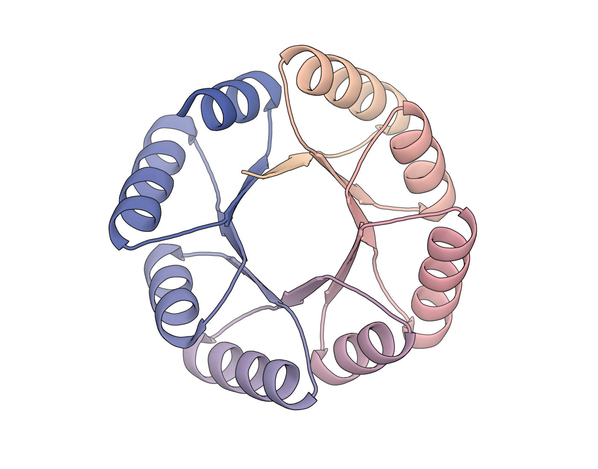
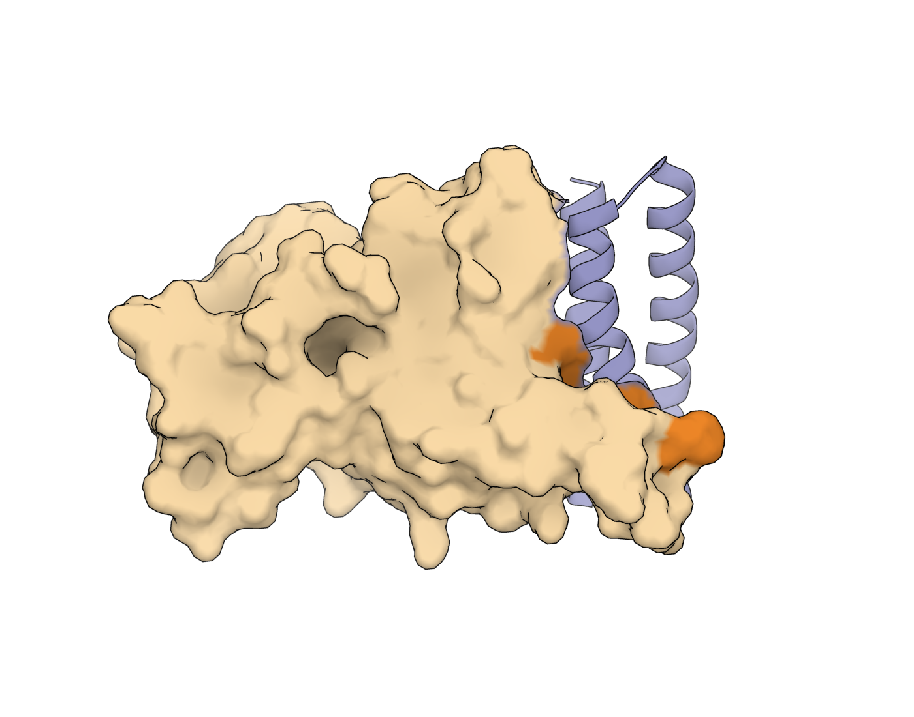
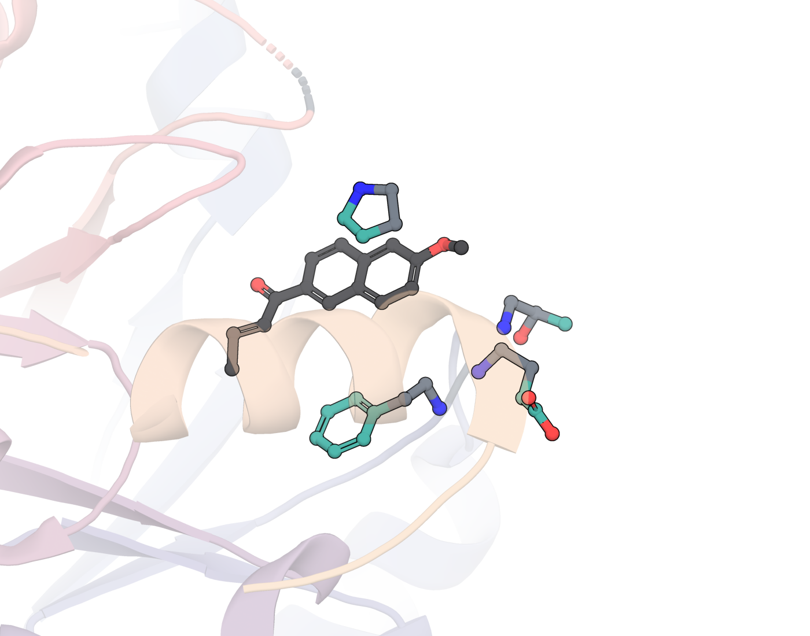
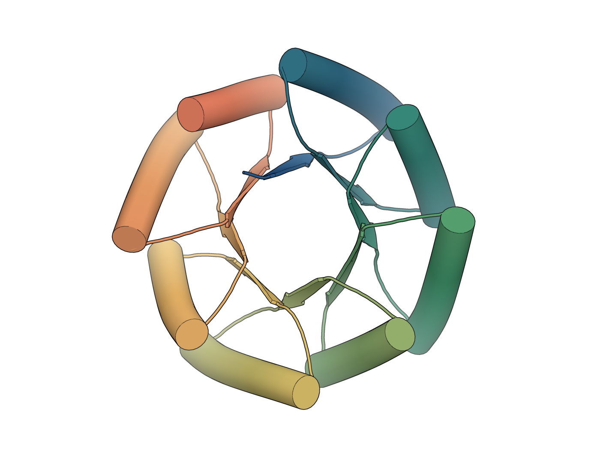
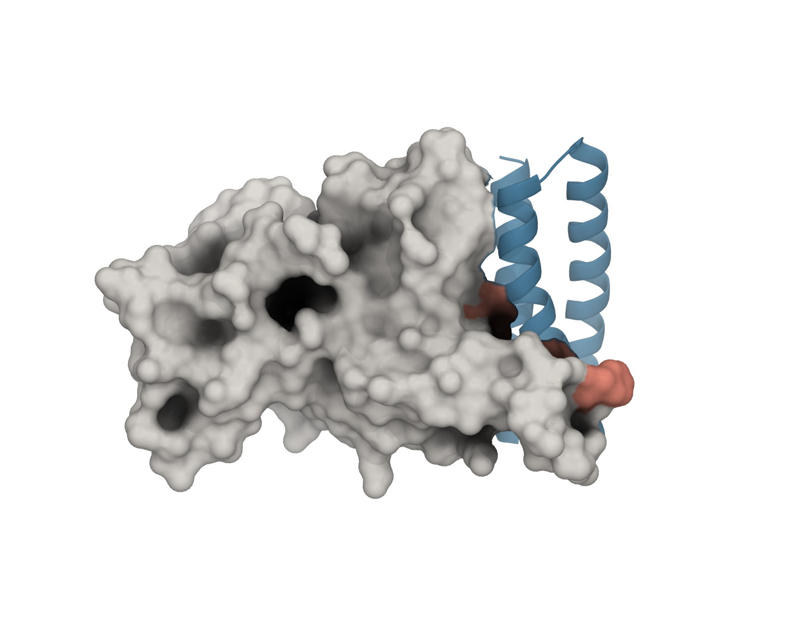
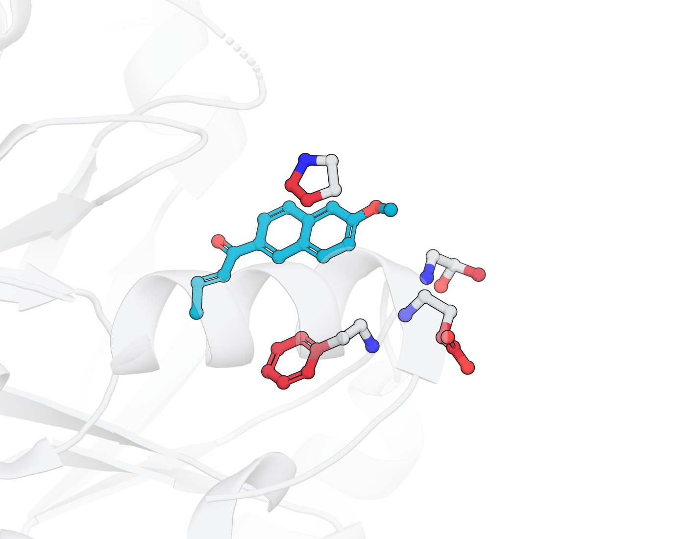
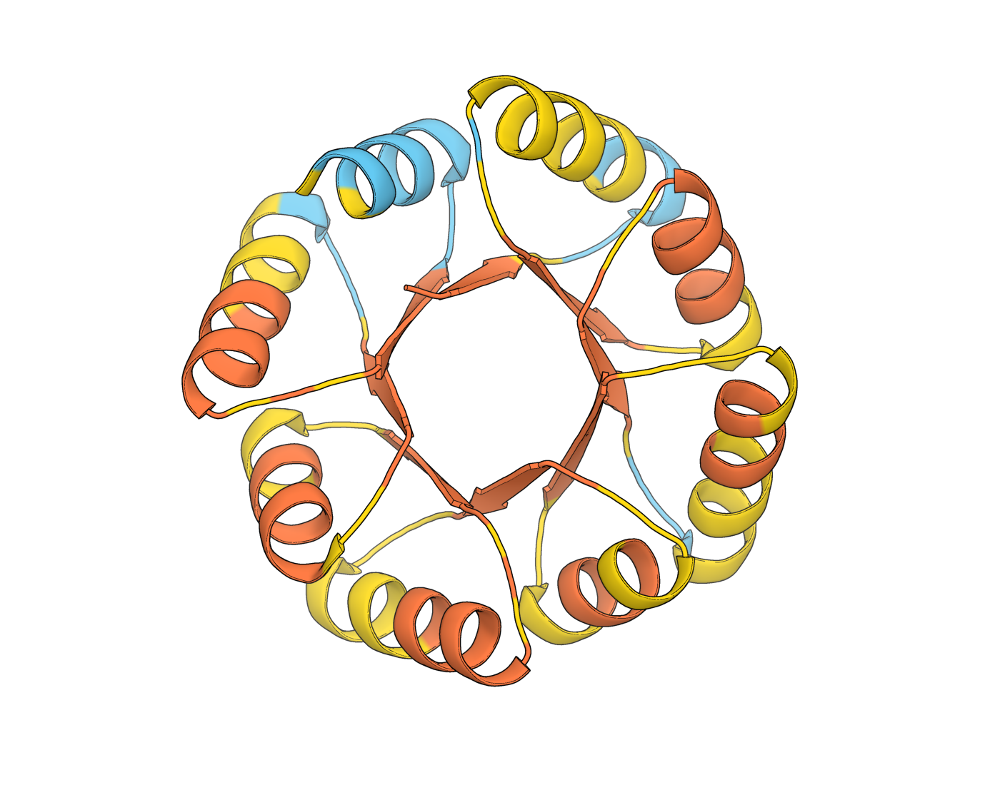

# pymol-publication-styles

An agent skill and Python/PyMOL rendering toolkit supporting **six classic publication-quality biomolecular visualization styles** — usable seamlessly across **Antigravity**, **Claude Code**, and **OpenAI Codex CLI**.

Every command automatically produces three files at `--out-prefix`:
- `<prefix>.png` — Ray-traced high-resolution image
- `<prefix>.pse` — Interactive PyMOL session
- `<prefix>.pml` — Standalone human-readable PyMOL script

---

## Style Gallery

### 1. `baker_rfd` *(Default)* — Baker Lab / IPD (RFdiffusion 1–3)

Derived directly from **RFdiffusion 1** (*Nature* 2023), **RFdiffusion All-Atom** (*Science* 2024), **RFdiffusion 2** (*Nature Methods* 2025/2026), and **RFdiffusion 3** (*bioRxiv* 2025) — explicitly avoiding RFD4's aesthetic. Features matte cel-shaded outlines (`ray_trace_mode=1`), soft pastel topology gradients (`#FCD4AC` → `#FCACB4` → `#9494C4` → `#5064AC`), signature motif/catalytic teal (`#4CB8AC`), warm sand target (`#FCDCA8`) + orange hotspot (`#F08828`), and charcoal all-atom ligands (`#48484C`).

| Monomer (`6WVS`) | Target–Binder Complex (`7UHB`) | Enzyme Active Site (`5AN7`) |
| :---: | :---: | :---: |
|  |  |  |

---

### 2. `goodsell` — David Goodsell / RCSB *Molecule of the Month* Watercolor Style

Full-atom space-filling spheres (`spheres`) with quantized cel-shaded outlines (`ray_trace_mode=3`), flat high-ambient lighting (`ambient=0.68`, `spec_reflect=0.0`), muted watercolor palettes, and gentle O/N heteroatom tints.

| Target–Binder Complex (`7UHB`) |
| :---: |
|  |

---

### 3. `cylindrical` — *Nature* / *Cell* Minimalist Cylindrical-Helix Architecture

Solid cylindrical α-helices (`cartoon_cylindrical_helices=1`), flat β-sheets, slim loops (`cartoon_loop_radius=0.16`), and high-clarity architectural gradients (`#2B5C8F` → `#3D9970` → `#E9C46A` → `#E07A5F`). Ideal for TIM barrels, GPCRs, ion channels, and membrane protein topology figures.

| TIM Barrel (`6WVS`) |
| :---: |
|  |

---

### 4. `chimerax_soft` — ChimeraX Soft-Shadow / Matte Ceramic AO Cryo-EM Style

Outline-free (`ray_trace_mode=0`) pure ambient-occlusion and soft-shadow shading (`ambient_occlusion_mode=1`, `ambient_occlusion_scale=25.0`, `ray_shadow=1`) with matte ceramic clay surfaces (`#D8D4CE`) and muted cobalt/salmon accents.

| Target–Binder Surface (`7UHB`) |
| :---: |
|  |

---

### 5. `spotlight` — Monochrome Ghost Scaffold + Jewel-Tone Focal Spotlight

Semi-transparent cool porcelain scaffold (`#E2E4E8`, `cartoon_transparency=0.62`) paired with opaque ball-and-stick focal catalytic residues and ligands in vivid crimson (`#E63946`) and cyan (`#00B4D8`).

| Active-Site Pocket (`5AN7`) |
| :---: |
|  |

---

### 6. `alphafold_plddt` — Canonical AlphaFold / ColabFold pLDDT Confidence Style

Auto-normalizes `0..1` and `0..100` B-factors and applies canonical confidence colors (`#0053D6` $\ge 90$, `#65CBF3` $70\text{–}90$, `#FFDB13` $50\text{–}70$, `#FF7D45` $< 50$) with crisp matte outlines. *(Example shown on crystal structure `6WVS` mapping crystallographic B-factors.)*

| Confidence Mapping (`6WVS`) |
| :---: |
|  |

---

## Cross-Agent Installation (Antigravity / Claude Code / Codex)

Clone once and symlink into whichever AI coding agent(s) you use:

```bash
# Clone to a central location (e.g. ~/.gemini/config/skills/ or ~/.agents/skills/)
git clone https://github.com/leslieqin-omg/pymol-publication-styles.git ~/.gemini/config/skills/pymol-publication-styles

# Enable in Claude Code
mkdir -p ~/.claude/skills
ln -sfn ~/.gemini/config/skills/pymol-publication-styles ~/.claude/skills/pymol-publication-styles

# Enable in OpenAI Codex CLI
mkdir -p ~/.codex/skills ~/.agents/skills
ln -sfn ~/.gemini/config/skills/pymol-publication-styles ~/.codex/skills/pymol-publication-styles
ln -sfn ~/.gemini/config/skills/pymol-publication-styles ~/.agents/skills/pymol-publication-styles
```

Works with either local open-source PyMOL (`python3 scripts/render_publication.py ...`) or `uv run scripts/render_publication.py ...` (auto-installs `pymol-open-source-whl` via PEP 723).

---

## CLI Quick Examples

```bash
# 1. Baker Lab / RFdiffusion 1-3 binder complex
python3 scripts/render_publication.py binder \
  --style baker_rfd \
  --complex complex.cif \
  --target-chain C --binder-chain K \
  --hotspots "resi 417+453+455+486+489+493" \
  --out-prefix output/binder_baker

# 2. Goodsell watercolor spheres
python3 scripts/render_publication.py binder \
  --style goodsell \
  --complex complex.cif \
  --target-chain C --binder-chain K \
  --out-prefix output/binder_goodsell

# 3. Minimalist cylindrical-helix barrel
python3 scripts/render_publication.py monomer \
  --style cylindrical \
  --structure barrel.cif \
  --out-prefix output/barrel_cylindrical

# 4. ChimeraX soft ceramic AO surface
python3 scripts/render_publication.py binder \
  --style chimerax_soft \
  --complex complex.cif \
  --target-chain C --binder-chain K \
  --out-prefix output/binder_chimerax

# 5. Monochrome ghost + jewel spotlight active site
python3 scripts/render_publication.py active_site \
  --style spotlight \
  --structure enzyme.cif \
  --catalytic-sele "resi 1057+1184+1185+1186" \
  --ligand-sele "resn LLK" \
  --out-prefix output/active_site_spotlight

# 6. AlphaFold pLDDT confidence
python3 scripts/render_publication.py monomer \
  --style alphafold_plddt \
  --structure model.cif \
  --out-prefix output/model_plddt
```
