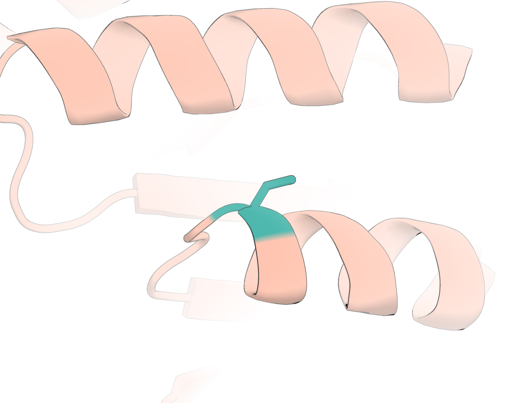
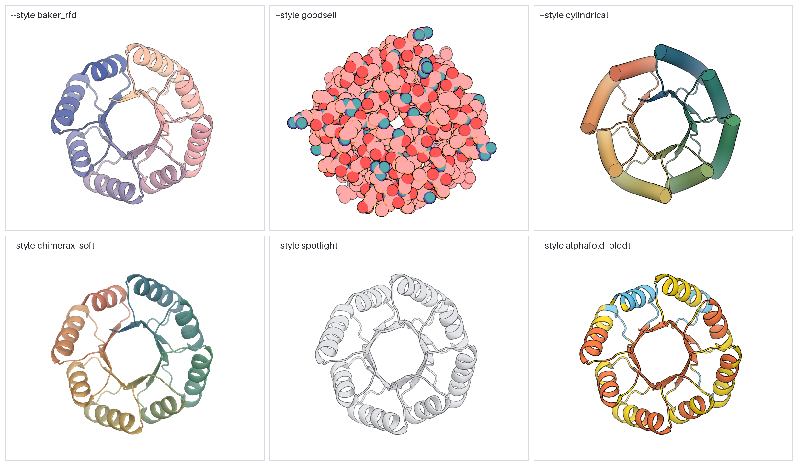
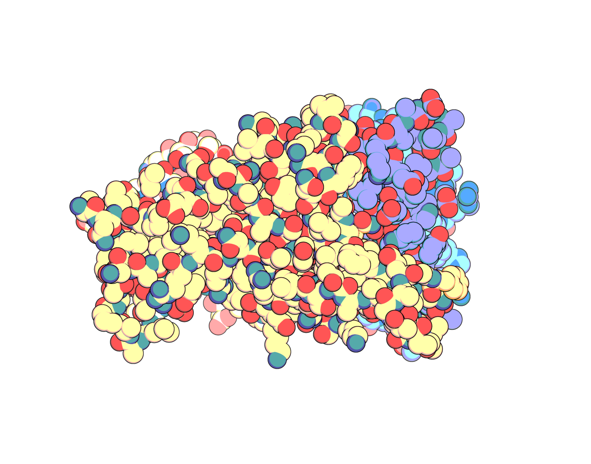
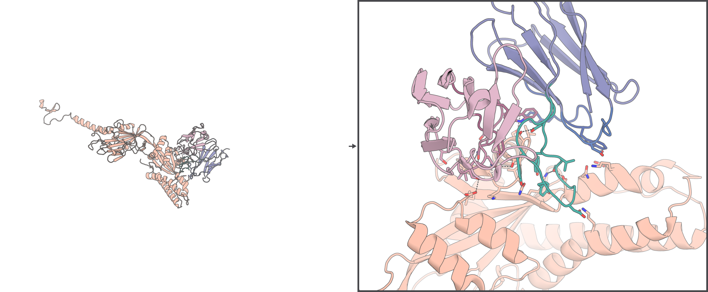
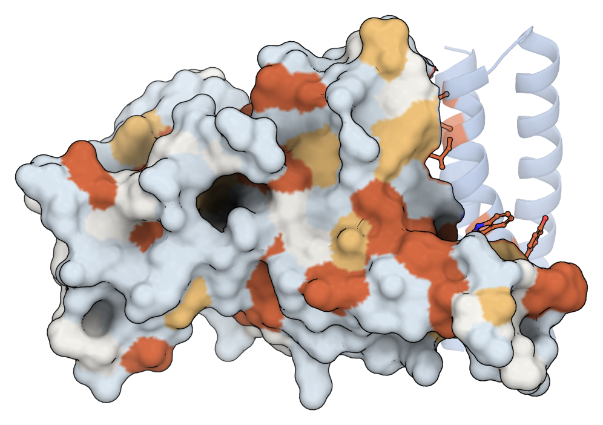
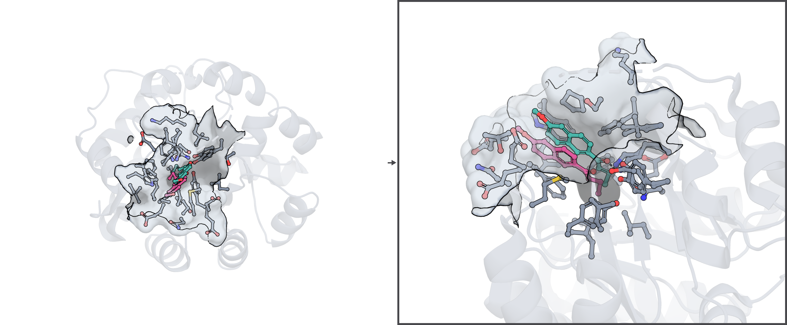
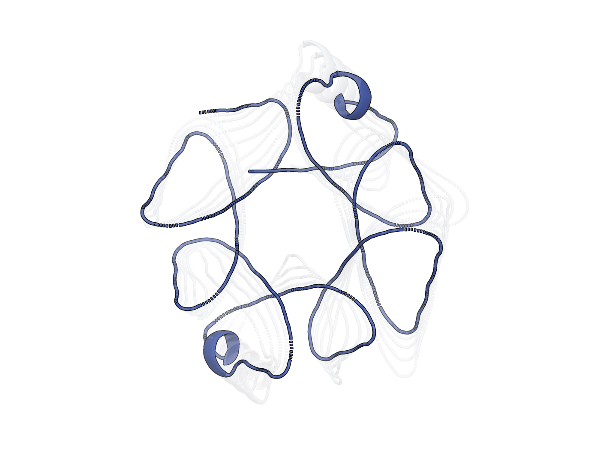
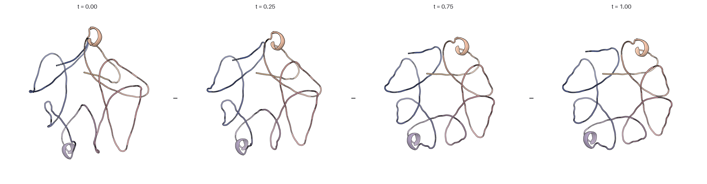

# pymol-publication-styles

An agent skill and Python/PyMOL rendering toolkit supporting **10 classic structural biology & AIDD publication styles** plus **automated multi-panel figure workflows** — usable seamlessly across **Antigravity**, **Claude Code**, and **OpenAI Codex CLI**.

Every single-view command emits three files at `--out-prefix`:
- `<prefix>.png` — Ray-traced high-resolution image (supports `--transparent` & `--auto-crop`)
- `<prefix>.pse` — Interactive PyMOL session
- `<prefix>.pml` — Standalone human-readable PyMOL script

And `--with-inset` automatically generates `<prefix>_global.png`, `<prefix>_inset.png`, and a framed side-by-side composite `<prefix>_composite.png`.

---

## Style Gallery (10 Built-In Styles)

### 1. `baker_rfd` *(Default)* — Baker Lab / IPD (RFdiffusion 1–3) & Paper Cutout Aesthetic
Matte paper-cutout cel-shaded outlines (`ray_trace_mode=1`, `ray_trace_color=gray30`, `specular=0`, `valence=0`, `power=0.2`, `ambient=0.4`), soft pastel topology gradients (`#FCD4AC` → `#FCACB4` → `#9494C4` → `#5064AC`), `paper_*` palettes (`paper_melon #FFC6B2` + `paper_teal #4FB9AF`), warm sand target (`#FCDCA8`) + orange hotspot (`#F08828`), and charcoal all-atom ligands (`#48484C`) — explicitly avoiding RFD4's aesthetic.

| Monomer (`6WVS`) | Target–Binder Complex (`7UHB`) | Enzyme Active Site (`5AN7`) | Mutation Zoom (`--color-mode melon --zoom-motif`) |
| :---: | :---: | :---: | :---: |
|  |  |  |  |

---

### 2–6. Classic Structural Biology Styles (`goodsell`, `cylindrical`, `chimerax_soft`, `spotlight`, `alphafold_plddt`)

Generated directly via `showcase --scene monomer`:

| 6-Style Same-Camera Showcase Grid (`6WVS`) |
| :---: |
|  |

| Goodsell Watercolor (`7UHB`) | ChimeraX Soft Ceramic AO (`7UHB`) | Monochrome Spotlight (`5AN7`) |
| :---: | :---: | :---: |
|  |  |  |

---

### 7–10. AIDD-Specialized Styles & Automated Figure Layouts

#### 7. `antibody_cdr` — Paper-Cutout Antibody CDR Loops & Interface Contacts (`antibody --with-inset`)
| Global Complex + Framed Fv CDR–Antigen Interface Inset (`5TPN`) |
| :---: |
|  |

#### 8. `hydrophobic_surface` — Physicochemical Complementarity (`binder --style hydrophobic_surface --transparent --auto-crop`)
| Eisenberg Hydrophobicity Surface + Hydrophobic Anchor Sticks (`7UHB`) |
| :---: |
|  |

#### 9. `pocket_cavity` — Local Pocket Cutaway + Pose Overlay & In-Pocket Ligand RMSD (`ligand_pocket --with-inset`)
| Global Scaffold + Cutaway Cavity & Overlaid Ligand Poses (`5AN7`) |
| :---: |
|  |

#### 10. `diffusion_ensemble` & `trajectory_strip` — Multi-State Ghosting & Time-Step Progression
| Multi-State Ensemble Ghosting (`diffusion_ensemble`) | Horizontal Time-Step Strip (`trajectory_strip`) |
| :---: | :---: |
|  |  |

---

## Cross-Agent Installation (Antigravity / Claude Code / Codex)

```bash
# Clone once
git clone https://github.com/leslieqin-omg/pymol-publication-styles.git ~/.gemini/config/skills/pymol-publication-styles

# Enable in Claude Code
mkdir -p ~/.claude/skills
ln -sfn ~/.gemini/config/skills/pymol-publication-styles ~/.claude/skills/pymol-publication-styles

# Enable in OpenAI Codex CLI
mkdir -p ~/.codex/skills ~/.agents/skills
ln -sfn ~/.gemini/config/skills/pymol-publication-styles ~/.codex/skills/pymol-publication-styles
ln -sfn ~/.gemini/config/skills/pymol-publication-styles ~/.agents/skills/pymol-publication-styles
```

Works with either local open-source PyMOL (`python3 scripts/render_publication.py ...`) or `uv run scripts/render_publication.py ...`.

---

## CLI Quick Examples

```bash
# 1. Antibody CDR loops + interface contacts + inset composite
python3 scripts/render_publication.py antibody \
  --complex ab_ag.cif --antigen-chain A --heavy-chain H --light-chain L \
  --with-inset --auto-crop --out-prefix output/antibody

# 1b. Paper-cutout single-site mutation / motif zoom
python3 scripts/render_publication.py monomer \
  --structure protein.cif --color-mode melon \
  --motif-sele "chain A and resi 276" --zoom-motif \
  --out-prefix output/mutation_276

# 2. Hydrophobic surface complementarity (transparent + auto-cropped)
python3 scripts/render_publication.py binder \
  --style hydrophobic_surface --complex complex.cif \
  --target-chain C --binder-chain K --transparent --auto-crop \
  --out-prefix output/hydrophobic_binder

# 3. Local pocket cutaway + ligand pose overlay + in-pocket heavy-atom RMSD
python3 scripts/render_publication.py ligand_pocket \
  --structure crystal.cif --reference pred.cif \
  --ligand-sele "resn LLK" --with-inset --auto-crop \
  --out-prefix output/pocket_rmsd

# 4. Diffusion / MD trajectory progression strip
python3 scripts/render_publication.py trajectory_strip \
  --structure traj.pdb --n-frames 4 --style baker_rfd \
  --out-prefix output/traj_strip

# 5. Same-camera style comparison sheet
python3 scripts/render_publication.py showcase \
  --structure design.cif --scene monomer --all-styles \
  --out-prefix output/style_grid
```
